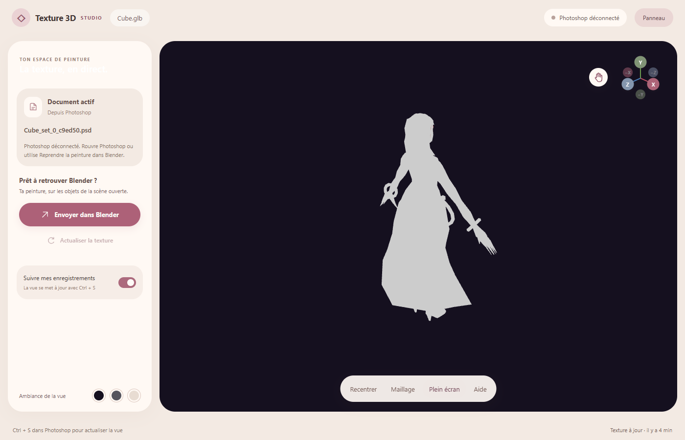
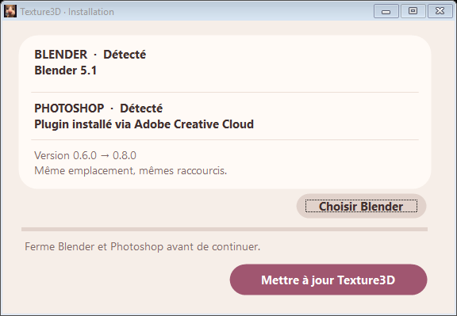

<div align="center">

# Texture3D

**Blender pour le modèle. Photoshop pour la peinture.**

Un outil pour peindre des textures dans Photoshop et visualiser le résultat sur un modèle 3D dans une fenêtre séparée.

[Télécharger](https://github.com/Kxrll/Texture3D/releases/latest) · [Installation](#installation) 



</div>

## Comment ça marche

Le travail commence dans Blender, sur un modèle dont les UV sont déjà préparés. Le bouton **Peindre dans Photoshop** prépare le document et ouvre le viewer. Ensuite, chaque **Ctrl + S** dans Photoshop actualise la texture sur le modèle.

Le bouton **Envoyer dans Blender** applique ensuite la texture à la scène ouverte.

- Tous les objets sélectionnés sur **un même document Photoshop**.
- Les UV d’origine conservés, sans nouveau dépliage ni compactage automatique.
- Des guides UV noirs, exclus de la texture envoyée.
- Une fenêtre 3D séparée pour travailler sur deux écrans.
- Rotation, zoom, déplacement, gizmo et affichage du maillage.

## Installation

**Windows 64 bits · Blender · Photoshop · Adobe Creative Cloud Desktop · Edge**

Testé avec Blender 5.1 et Photoshop 27.11. Versions minimales déclarées : Blender 4.2 et Photoshop 26.

1. Télécharge **Texture3D-Setup-0.8.0.exe** dans [la release](https://github.com/Kxrll/Texture3D/releases/tag/v0.8.0).
2. Ferme Blender et Photoshop, puis lance l’installateur.
3. Ouvre Blender, sélectionne ton modèle et retrouve **Texture3D** dans la barre latérale avec **N**.

Si une ancienne version est installée, lance directement le nouvel installateur. Il remplace l’application au même emplacement et conserve tes projets. Pas besoin de désinstaller avant.

<details>
<summary>Voir l’installateur</summary>



</details>

La release contient aussi une **version portable** et un **pack RAR avec les deux versions**. Le plugin Photoshop reste nécessaire en portable. Le [guide](installer/LISEZ-MOI-RELEASE.txt) explique les étapes et le fonctionnement sans droits administrateur. L’exécutable n’est pas signé ; les règles du PC ou d’Adobe peuvent bloquer son installation.

## À savoir

Les UV doivent être prêts dans Blender et rester dans le carré 0–1. Des UV superposés partagent la même peinture sur le document commun. L’outil ne déplace pas les îlots pour les séparer.

Les anciens projets utilisant le premier système d’atlas ne sont pas convertis automatiquement : il peut être nécessaire de créer un nouveau projet Texture3D. Garde tes anciens PSD et fichiers Blender.

## Le code source

Tout le code est ici : viewer, service local, plugin Photoshop, extension Blender, installateur et tests. Les exécutables sont dans les releases ; les projets personnels et les clés locales ne sont pas dans Git.

```powershell
git clone https://github.com/Kxrll/Texture3D.git
cd Texture3D
npm ci
node init-config.cjs
npm run build
npm run check
```

Pour brancher les applications aux sources, reconstruire l’installateur ou reprendre sur un autre ordinateur : **[guide de développement](docs/DEVELOPPEMENT.md)**.

## Un souci ?

Ouvre une [issue](https://github.com/Kxrll/Texture3D/issues) avec les versions de Blender et Photoshop, ce que tu faisais et le message d’erreur. Une capture aide aussi.
