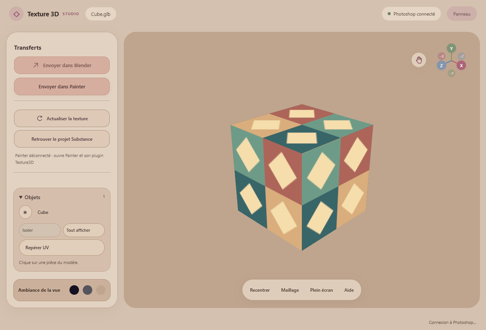
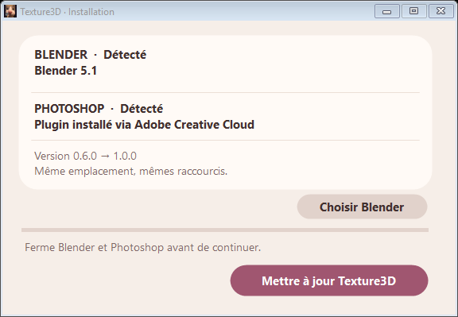

<div align="center">

# Texture3D Studio

**Peindre dans Photoshop, voir le résultat sur le modèle 3D.**

[Télécharger Texture3D Studio 1.0.1](https://github.com/Kxrll/Texture3D/releases/latest) · [Installation](#installation) · [Substance 3D Painter](docs/PAINTER.md)



</div>

## De Blender à Photoshop

1. Dans Blender, préparer les UV, sélectionner le modèle et cliquer sur **Texture3D → Peindre dans Photoshop**.
2. Peindre dans le document Photoshop commun. Chaque **Ctrl + S** actualise la texture dans le viewer, qui peut rester ouvert sur un deuxième écran.
3. Utiliser **Envoyer dans Blender** pour appliquer la texture dans la scène ouverte, ou **Envoyer dans Painter** pour l’appliquer à la **Base Color** dans Substance 3D Painter.

Texture3D garde les UV d’origine et exclut les guides du rendu. Dans le viewer, cliquer sur une pièce affiche son maillage. Il est aussi possible de l’isoler ou de [repérer la zone à peindre sur les UV](docs/OBJETS-ET-UV.md).

Les UV doivent tenir dans le carré 0–1. Les îlots superposés partagent la peinture sur le document commun.

## Installation

**Windows x64 · Blender · Photoshop · Adobe Creative Cloud Desktop · Microsoft Edge**

Les versions minimales déclarées sont Blender 4.2 et Photoshop 26.

1. Télécharger **Texture3D-Setup-1.0.1.exe** dans la [release officielle](https://github.com/Kxrll/Texture3D/releases/tag/v1.0.1).
2. Fermer Blender et Photoshop, puis lancer l’installateur.
3. Dans Blender, ouvrir la barre latérale avec **N** et choisir **Texture3D**.

<details>
<summary>Voir l’installateur</summary>



</details>

Pour mettre à jour une installation existante, lancer directement le nouveau programme d’installation. Il reprend le même emplacement et conserve les projets. L’installation se fait dans le compte Windows courant. Les règles Windows ou Adobe peuvent bloquer l’exécutable non signé ou l’installation du plugin.

Quand Substance 3D Painter est détecté, l’installateur prépare aussi son plugin. Il se charge au prochain lancement de Painter. [Voir le guide Painter](docs/PAINTER.md). Après le premier envoi, enregistrer le projet en `.spp`. Le viewer permet ensuite de le reprendre avec **Retrouver le projet Substance**.

## Code source

Le dépôt contient le viewer, le service local, les plugins Blender, Photoshop et Painter, l’installateur et les tests. Les archives **Source code** de la release correspondent à la version publiée.

```powershell
git clone https://github.com/Kxrll/Texture3D.git
cd Texture3D
npm ci
node init-config.cjs
npm run build
```

Le [guide de développement](docs/DEVELOPPEMENT.md) explique comment brancher les applications, tester et reconstruire l’installateur. Pour signaler un problème, ouvrir une [issue](https://github.com/Kxrll/Texture3D/issues) avec les versions des applications et les étapes pour le reproduire.
